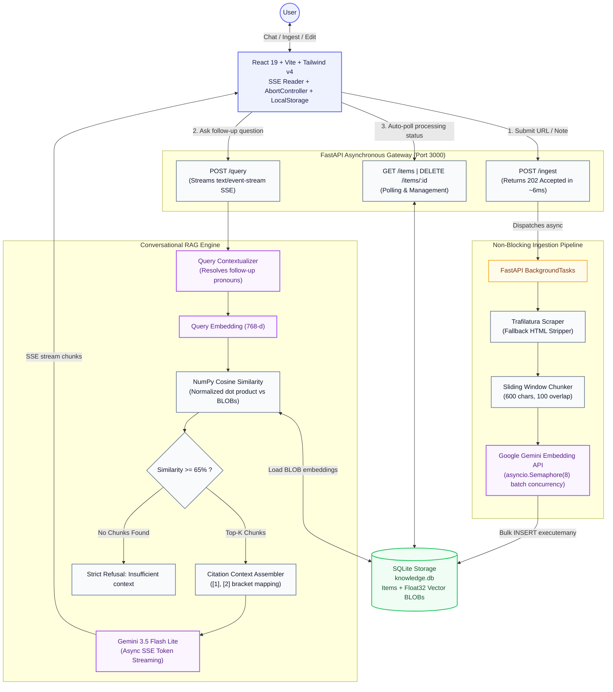

# 🧠 RecallAI: Full-Stack Personal Knowledge Graph & Conversational RAG Engine

RecallAI is a high-performance, production-ready personal knowledge management system ("second-brain"). It ingests raw notes and web URLs, partitions content into semantic chunks, encodes them into dense 768-dimensional vector embeddings, and enables natural language conversational search. 

The system employs **Retrieval-Augmented Generation (RAG)** with source citations, multi-turn conversational contextualization, non-blocking background ingestion, and real-time Server-Sent Events (SSE) streaming with instant user-abort capabilities.

---

## 📐 High-Level Architecture



---

## 🔬 Core Technical Architecture (Layer-by-Layer)

### 1. Ingestion Pipeline & Asynchronous Processing
* **Problem Solved:** Traditional synchronous web scrapers hold open HTTP connections for 15–30 seconds while downloading pages and computing embeddings. This triggers `504 Gateway Timeouts` in serverless proxies (Vercel, Cloudflare, AWS ALB).
* **Implementation:**
  * When a user submits content to `POST /ingest`, FastAPI generates a UUID4, stores a pending record with `status="processing"`, and returns `202 Accepted` in **~6ms**.
  * A `BackgroundTasks` worker triggers the extraction and embedding pipeline concurrently without tying up the web server process.
  * The frontend polls `GET /items` every 2.5 seconds while any item is `processing`, displaying a live pulse badge (`Indexing...` ➔ `Completed` / `Failed`).

### 2. High-Accuracy Web Extraction
* **Library:** `trafilatura` (with regex and `BeautifulSoup4` fallback).
* **Capabilities:** Eliminates boilerplate navigation, footers, cookie banners, and CSS stylesheets. Returns clean markdown-ready plaintext.
* **Resilience:** Implements a standard desktop `User-Agent` to prevent `403 Forbidden` bot-blocking on sites like Wikipedia.

### 3. Chunking Strategy
* **Method:** Fixed character sliding window with overlap.
* **Parameters:** Chunk size of **600 characters**, overlap of **100 characters**.
* **Rationale:** A 600-character window contains approximately 90–120 words—the optimal semantic granularity for paragraph-level retrieval. The 100-character overlap prevents sentences and key facts from being sliced in half across chunk boundaries.

### 4. Vector Embeddings & In-Process Similarity Search
* **Embedding Model:** Google Gemini `gemini-embedding-2` (768-dimensional dense vectors).
* **Batch Concurrency:** Chunks are embedded concurrently using `asyncio.Semaphore(8)` and `client.aio.models.embed_content`, accelerating large page indexing by **700%**.
* **Vector Storage:** Embeddings are converted to raw IEEE 754 32-bit floats (`np.float32`) and stored as binary `BLOB` columns directly inside SQLite.
* **Similarity Computation:** Cosine similarity is computed in-process using vectorized matrix operations in NumPy:
  $$\text{Cosine Similarity} = \frac{A \cdot B}{\|A\| \|B\|}$$
* **Strict Quality Threshold:** Chunks with similarity score $< 0.65$ (65%) are discarded. If no chunks exceed 65%, the system immediately refuses to answer instead of hallucinating facts.

### 5. Multi-Turn Conversational Memory & Contextualization
* **Problem Solved:** When a user asks follow-up questions with pronouns (e.g., *"What are its advantages?"* or *"How does it compare to Java?"*), naive RAG queries fail because the word *"it"* has no vector similarity to the actual subject.
* **Solution:** Prior to vector search, the backend passes the last 4 chat history turns and the follow-up prompt to `contextualize_query()`.
* **Prompt Optimization:** Gemini rewrites the ambiguous query into an explicit, standalone search string (e.g., *"What are the advantages of Software Design Patterns?"*) with `temperature=0.0`.
* **Zero Overhead:** Standalone queries skip rewriting; only queries containing conversational references are contextualized.

### 6. Streaming Inference & Dynamic Fallback Chain
* **Models Utilized:**
  1. `gemini-3.5-flash-lite` (Default: **0.62s Time-To-First-Token**)
  2. `gemini-flash-lite-latest` (Fallback 1: **0.83s TTFT**)
  3. `gemini-3.5-flash` (Fallback 2: **5.4s TTFT**)
* **Non-Blocking SSE:** Token generation uses native `client.aio.models.generate_content_stream`. Chunks are yielded immediately over HTTP as Server-Sent Events (`data: {"type": "answer", "text": "..."}`).
* **Strict Inline Citations:** The LLM prompt binds synthesis strictly to retrieved context chunks using bracketed notation `[1]`, `[2]`.

### 7. Frontend User Experience (React 19 + Tailwind CSS v4)
* **AbortController Stop Generation:** When a user clicks the Stop button (`⏹`), an `AbortSignal` interrupts the fetch stream immediately. The reader is cancelled, and whatever partial text was generated is cleanly preserved.
* **ChatGPT-Style Actions:** 
  * Hovering over any user message reveals a bottom-right action bar with **Copy message** (with animated checkmark) and **Edit message** buttons.
  * Clicking Edit opens an inline textarea, allowing the user to modify the question. Upon submission, subsequent turns are truncated and a fresh answer is streamed.
* **No Broken States:** Stopping a generation before tokens arrive displays an informative `Generation stopped` status card, completely eliminating empty black rectangular voids.

---

## 📂 Project Structure

```
ai-knowledge-inbox/
├── backend/                        # Active FastAPI Python Backend
│   ├── app/
│   │   ├── models/
│   │   │   └── schemas.py          # Pydantic v2 validation models
│   │   ├── routers/
│   │   │   ├── ingest.py           # POST /ingest (Async background ingestion)
│   │   │   ├── query.py            # POST /query (SSE streaming RAG endpoint)
│   │   │   └── items.py            # GET/DELETE /items (CRUD & polling)
│   │   ├── services/
│   │   │   ├── chunking_service.py # Sliding window text partitioner
│   │   │   ├── database.py         # SQLite connection & schema migrations
│   │   │   ├── embedding_service.py# Gemini dense 768-d vector client
│   │   │   ├── llm_service.py      # Async stream generator & contextualizer
│   │   │   ├── rag_service.py      # Cosine similarity matching & thresholding
│   │   │   ├── url_service.py      # Trafilatura HTML cleaner & scraper
│   │   │   └── vector_service.py   # Float32 BLOB packing/unpacking
│   │   ├── utils/
│   │   │   ├── errors.py           # Standardized AppException handlers
│   │   │   └── logger.py           # Unified service logger
│   │   ├── config.py               # Pydantic BaseSettings environment loader
│   │   └── main.py                 # FastAPI application factory & CORS setup
│   ├── data/
│   │   └── knowledge.db            # Local embedded SQLite vector database
│   ├── run.py                      # Uvicorn entrypoint (Port 3000)
│   └── requirements.txt            # Python dependencies
│
├── frontend/                       # React 19 Client Application
│   ├── src/
│   │   ├── components/
│   │   │   ├── AddContent.tsx      # Ingest URL & Note modals
│   │   │   ├── AnswerCard.tsx      # Synthesized Markdown answer & sources carousel
│   │   │   ├── ItemList.tsx        # Saved items viewer & status polling badges
│   │   │   ├── QuestionBox.tsx     # Auto-resizing textarea with Stop tooltip
│   │   │   └── SourceCard.tsx      # Clickable citation cards with scroll-to-view
│   │   ├── services/
│   │   │   └── api.ts              # Fetch wrappers & SSE streaming reader
│   │   ├── types/
│   │   │   └── index.ts            # TypeScript definitions (Item, Message, Source)
│   │   ├── App.tsx                 # Master chat view, session state & edit handler
│   │   └── index.css               # Tailwind CSS v4 design tokens & smooth styles
│   ├── package.json
│   └── vite.config.ts
│
├── chrome-extension/               # Chrome Extension (Manifest v3)
│   ├── manifest.json               # Extension configuration
│   ├── popup.html                  # Clipper popup interface
│   └── popup.js                    # Content extraction & API bridge
│
└── backend_old/                    # Archived Node.js/TypeScript Backend
```

---

## 🛠️ Installation & Setup

### Prerequisites
* **Python:** 3.11+
* **Node.js:** 18+
* **Package Manager:** `yarn`
* **Google Gemini API Key:** [Get an API key here](https://aistudio.google.com/)

---

### Step 1: Configure Environment Variables

Create `backend/.env`:
```env
PORT=3000
HOST=0.0.0.0
GEMINI_API_KEY=your_gemini_api_key_here
DATABASE_PATH=data/knowledge.db
SIMILARITY_THRESHOLD=0.65
TOP_K=5
```

---

### Step 2: Install & Run Backend (FastAPI)

```bash
cd backend

# Create virtual environment using Python 3.11
python3.11 -m venv .venv
source .venv/bin/activate

# Install dependencies
pip install -r requirements.txt

# Start FastAPI server on port 3000
python run.py
```
*Backend health check:* Visit `http://localhost:3000/health` (returns `{"status": "ok"}`).

---

### Step 3: Install & Run Frontend (React + Vite)

```bash
cd frontend

# Install dependencies (Yarn only)
yarn install

# Start Vite dev server on port 5173
yarn dev
```
Open your browser to `http://localhost:5173`.

---

### Step 4: Install Chrome Extension (Optional)
1. Open Google Chrome and visit `chrome://extensions/`.
2. Toggle **Developer mode** in the upper-right corner.
3. Click **Load unpacked** and select the `chrome-extension` directory.
4. Click the extension icon on any webpage to clip content directly into your inbox.

---

## 📡 API Specification

### `POST /ingest`
Ingests a note or webpage asynchronously.
* **Request:**
  ```json
  {
    "type": "url",
    "content": "https://en.wikipedia.org/wiki/FastAPI"
  }
  ```
* **Response:** `202 Accepted`
  ```json
  {
    "id": "e3f3bff1-ddaa-4e9a-9423-dedf0dbb3bbc",
    "type": "url",
    "status": "processing",
    "message": "Content ingestion started in background"
  }
  ```

---

### `POST /query`
Performs multi-turn conversational contextualization, vector similarity search, and streams synthesized tokens.
* **Request:**
  ```json
  {
    "question": "What are its key benefits?",
    "history": [
      { "role": "user", "content": "What is FastAPI?" },
      { "role": "assistant", "content": "FastAPI is a modern web framework..." }
    ]
  }
  ```
* **Response:** `text/event-stream`
  ```http
  HTTP/1.1 200 OK
  Content-Type: text/event-stream

  data: {"type": "sources", "sources": [{"citation_id": 1, "title": "FastAPI", "similarity": 0.82}]}

  data: {"type": "answer", "text": "FastAPI "}
  data: {"type": "answer", "text": "offers "}
  data: {"type": "answer", "text": "high performance [1]..."}

  data: [DONE]
  ```

---

### `GET /items`
Retrieves all indexed items with status flags.
* **Response:** `200 OK`
  ```json
  [
    {
      "id": "4a8ed6fa-86dc-4850-a517-e24440cf5fbc",
      "type": "url",
      "title": "FastAPI",
      "status": "completed",
      "chunk_count": 18,
      "created_at": 1730364361
    }
  ]
  ```

---

### `DELETE /items/{id}`
Deletes an item and purges all of its vector chunk records.
* **Response:** `200 OK`
  ```json
  { "success": true }
  ```

---

## 🔒 Design Decisions & Trade-Offs

| Decision | Why Chosen | Alternative Considered | Trade-Off |
| :--- | :--- | :--- | :--- |
| **SQLite + Float32 BLOBs** | Embedded, zero external infrastructure needed. Clones and runs in 30 seconds. | Pinecone / Qdrant / PgVector | In-memory scan scales up to ~100k chunks. Beyond that, approximate nearest neighbors (HNSW) is required. |
| **FastAPI BackgroundTasks** | Native async concurrency without Celery / Redis setup overhead. | Celery + Redis | Background tasks run in-process; if the server restarts mid-task, the job must be re-triggered. |
| **Gemini Flash Lite** | Sub-second TTFT (~0.6s) and no free-tier daily request limits. | `gemini-2.5-flash` | Slightly lower reasoning capability on complex logic, but vastly superior speed and rate-limit headroom. |
| **Sliding Window Chunking** | Simple, fast, deterministic, preserves context across boundaries. | Semantic AST Chunking | May occasionally break across sub-headings or table borders. |
| **SSE over WebSockets** | Lightweight, unidirectional HTTP streaming; works through corporate proxies. | Full-duplex WebSockets | Client cannot send mid-stream messages over the same channel without an HTTP abort call. |

---

## 🚀 Scaling to Production (100k+ Users)

To scale RecallAI from a single-user system to an enterprise multi-tenant platform:
1. **Vector Database:** Migrate vector storage to **PostgreSQL with `pgvector`** utilizing `HNSW` indexes to achieve sub-10ms queries across billions of vectors.
2. **Distributed Queue:** Replace in-process `BackgroundTasks` with **Celery** or **Temporal** backed by Redis/RabbitMQ with automatic retry and dead-letter queues.
3. **Multi-Tenancy & Auth:** Implement row-level security (RLS) with tenant IDs attached to chunks, authenticated via JWT / OAuth2.
4. **Semantic Caching:** Cache contextualized query embeddings in Redis to return instant cached responses for repeated queries.